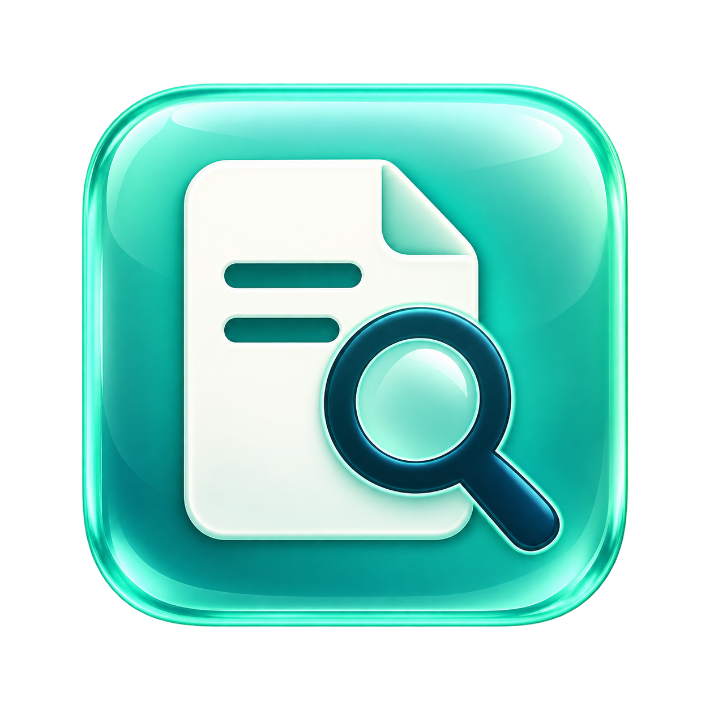

# E-rate Form 470 / 471 Lookup Tool



A portable C#/.NET 10 desktop tool for finding published certified E-rate Form 470 and Form 471 applications by BEN and funding year. Windows uses Windows Forms; macOS uses Avalonia. Both share the lookup, export, budget, and SQLite code.

**Version 1.0.0 · MIT license · Windows x64 and macOS Arm64/x64**

## Download and run

Open this repository's **Releases** page and select **v1.0.0**. GitHub's automatic source ZIP contains source code; download a platform ZIP to run the app.

| Release asset | Computer | Install first |
| --- | --- | --- |
| `ERateLookup-v1.0.0-win-x64.zip` | Windows x64 | .NET 10 Desktop Runtime, Windows x64 |
| `ERateLookup-v1.0.0-macos-arm64.zip` | Apple Silicon Mac | .NET 10 Runtime, macOS Arm64 |
| `ERateLookup-v1.0.0-macos-x64.zip` | Intel Mac | .NET 10 Runtime, macOS x64 |

Get the matching runtime from [Microsoft's .NET 10 download page](https://dotnet.microsoft.com/en-us/download/dotnet/10.0). Windows requires the **Desktop Runtime**. macOS requires the standard **.NET Runtime**. The SDK is needed only for development and builds. Runtime files are not bundled in these downloads.

Extract the ZIP, then run `ERate470Lookup.exe` on Windows or `ERateLookup.app` on macOS. Keep the Mac .app bundle intact. Mac builds target macOS 14 or later and are unsigned, non-notarized previews. For a blocked app you trust, use the per-app **Open Anyway** option in macOS Privacy & Security.

## Features

- Choose Form 470 or Form 471, funding year, and an exact BEN or California customer-name suggestion.
- Search names locally after two characters, with up to 15 suggestions.
- View all distinct certified applications in the published dataset, one row per application.
- View C2 budget snapshot information with forecast labeling where applicable.
- Select all, unselect all, or choose individual/range selections; export only selected filings to CSV or Excel.
- Choose Mint Glass, Midnight, or Classic themes. The app remembers your choice.
- Use bundled seed data to create the local SQLite database without an initial download.

Successful filing queries are cached for two hours by **BEN + funding year + form type**. Each successful query replaces only its own cache entry. Directory and budget snapshots refresh separately when at least 24 hours old, retaining existing records if refresh fails. USAC query failures are shown as errors rather than reported as no filings.

## First test

Try CENIC, **BEN 225495**, **Form 470**, **FY2027**. A previous live verification returned four applications. Select two and check that CSV and Excel contain only those selected filings. Live counts may change as USAC publishes data.

## Build from source

Install the .NET 10 SDK. Open this folder in VS Code or open `ERate470Lookup.sln` in Visual Studio.

```sh
dotnet run --project Checks/Checks.csproj -c Release
```

On Windows, use `Run-Windows.bat` to launch from source or `Publish-Windows.bat` to create the framework-dependent EXE under `publish/win-x64-framework`.

On macOS, install Python 3 as well, then run:

```sh
bash Publish-Mac.sh osx-arm64
# Intel:
bash Publish-Mac.sh osx-x64
```

## GitHub Actions and releases

The workflow builds on pushes and pull requests to `main`. Pushing a `v*` tag builds Windows and both Mac architectures, runs the shared checks, and attaches the platform ZIP files to a GitHub Release.

```sh
git add .
git commit -m "Describe the change"
git push origin main
# Choose an unused version for the next release:
git tag v1.0.1
git push origin v1.0.1
```

Keep executables, ZIPs, caches, and user settings out of the source repository; `.gitignore` excludes them. Compiled files belong in Releases. Each package includes instructions, the MIT license, and third-party notices.

## Project layout

| Path | Purpose |
| --- | --- |
| `Core/` | USAC queries, cache, seed data, budget display logic, and exports |
| `Desktop/` | Windows Forms interface |
| `MacDesktop/` | Avalonia interface for macOS |
| `Assets/` | PNG, ICO, and ICNS app icon |
| `Checks/` | Shared verification program |
| `scripts/package_mac.py` | Creates Mac app bundles and ZIP files |
| `.github/workflows/windows.yml` | Build and release automation |

## Current limitations

GUI launch and appearance still require hands-on Windows and Mac testing. Packages are unsigned. The funding-year selector currently covers 2016–2027; local name suggestions cover California. USAC data publishing delays can affect filing results. Budget figures are snapshot information, not a substitute for USAC's authoritative records. This project is independent of USAC.

See [Windows user guide](docs/USER_GUIDE.md), [Mac instructions](MACOS_README.md), [validation record](VALIDATION.md), and [release notes](RELEASE_NOTES.md).

## License

Original project code and documentation are available under the [MIT License](LICENSE). Third-party components and USAC data retain their own terms; see [THIRD_PARTY_NOTICES.md](THIRD_PARTY_NOTICES.md).

## iPhone and iPad development preview

A native C# / UIKit port is in [`iOS/`](iOS/README.md). It shares the existing query, bundled data, SQLite, and export core. See the iOS guide for simulator builds, free Personal Team testing, signing, and App Store steps. It is not yet a tested iPhone release.
